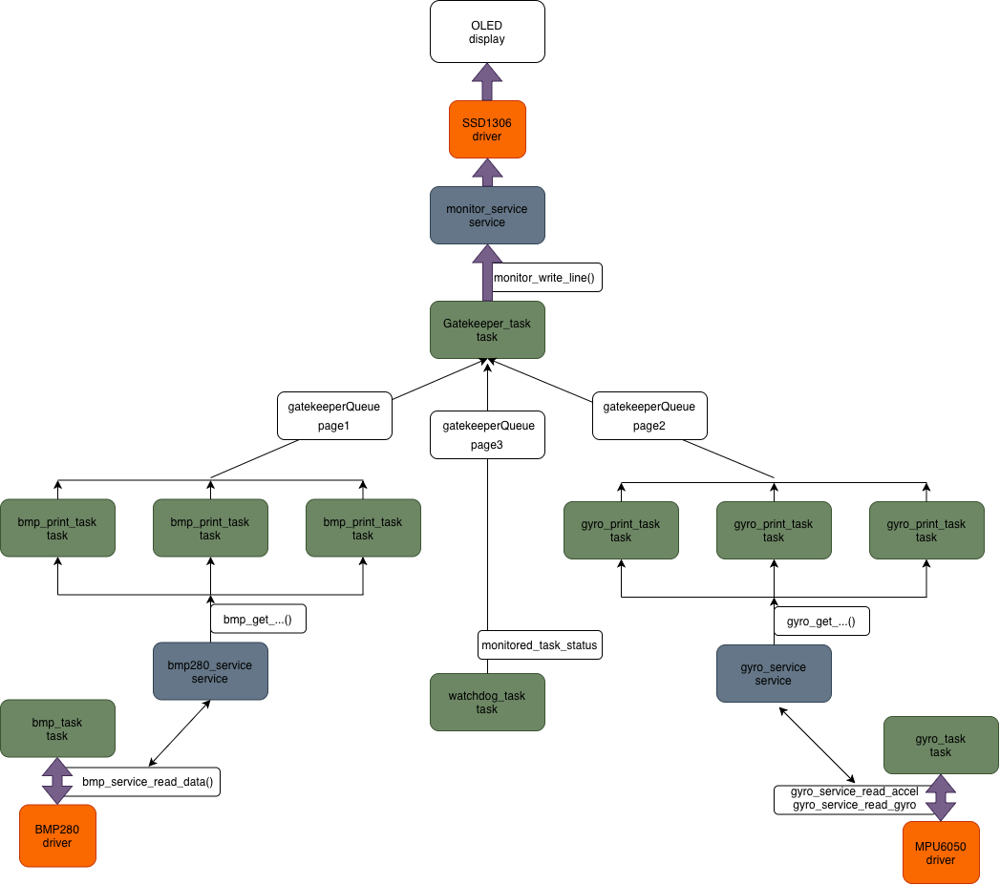

# STM32F446RE FreeRTOS Sensor Hub & UI Gatekeeper. V2.0.

## Overview

This repository contains a modular, real-time embedded system built on the **STM32F446RE** microcontroller using **FreeRTOS**.

The main objective of the project is to build a reliable telemetry and UI pipeline that reads data from environmental and motion sensors (BMP280, MPU6050) and renders updates on an OLED display via the shared I2C bus. The architecture avoids data races, minimizes ISR latency, and ensures high real-time predictability.

### Key Highlights:

- **Race-condition safe I2C Access:** Implemented the **Gatekeeper Task** pattern to serialize OLED display writes and minimized bus transactions by caching data and implementing smart screen updates (`monitor_flush`).
- **Low Interrupt Latency:** Used **Deferred Interrupt Processing** (such as `vTaskNotifyGiveFromISR`) to hand off hardware button events from ISRs to RTOS tasks safely.
- **Deterministic Timing:** Measured and optimized task jitter on I2C bus speeds (100 kHz & 400 kHz) using a Saleae Logic Analyzer.
- **Memory Optimization:** Task stack allocation verified in real time via `uxTaskGetStackHighWaterMark` with a strict +30% safety margin.
- **Fault-Tolerant Watchdog Supervision & Diagnostics:** Powered by a dual-layer watchdog architecture (software task-monitoring with min/max intervals + hardware Independent Watchdog IWDG). In case of a crash, a `.noinit` RAM section captures the offending task's name for post-mortem RCC reset flag analysis.
- **Robust Error Hooks & Bus Recovery:** Features dedicated FreeRTOS hooks for stack overflow and malloc failures (`vApplicationStackOverflowHook`, `vApplicationMallocFailedHook`), alongside a custom automated I2C bus recovery routine (`i2c_bus_recover`) that clears stuck SDA lines via 9 SCL clock pulses without requiring a full board restart.
- **Graceful Degradation & Task Statuses:** Peripheral errors (e.g., sensor disconnections) do not crash the node; instead, tasks report live error states (`OK`, `SENSOR_ERROR`, `BUS_ERROR`) directly to dedicated UI status pages.

## Run

```
make clean
make -j8
st-flash --reset write build/freertos_446.bin 0x08000000
```

`main.c` already has all needed tasks for work.

## Project structure

```
Project/
│
├──docs/
│   ├──v1.0/ ... Documentation for v1.0
│   └──v2.0/ ... Documentation for v2.0
├──Core/
│   ├── Inc/
│   │   ├── tasks/ ... FreeRTOS tasks. (bmp_task, gatekeeper and exc.)
│   │   ├── services/ ... Services that tasks uses for its work. (monitor_service, i2c_bus and exc.)
│   │   ├── handlers/ ... Interrupts handlers (ISR)
│   │   └── testing/ ... Testing functions (stack_size, jitter_test and exc.)
│   │
│   ├── Src/
│   │   ├── tasks/
│   │   ├── services/
│   │   ├── handlers/
│   └── └── testing/
│
├──Drivers/
│   ├── BMP280/ ... Driver for sensor BMP280
│   ├── MPU6050/ ... Driver for sensor MPU6050
└── └── SSD1306/ ... Driver for OLED-display SSD1306
```

## Project Architecture



Used patterns:

- Gatekeeper (gatekeeper_task.c)
- Deferred interrupts processing (btn_handler.c)
- Task notifications (btn_handler.c)
- Mutex (i2c_bus.c).
- Producer-consumer pattern. (gatekeeperQueue).
- Layered Architecture (project structure).

## Sensors scheme

`STM32F446RE` we will connect in that way:  
_Note: template is <board_pin> - <sensors_pin>._

1. `3v3` : `bmp_VDD`, `ssd_VDD` and `gyro_VCC`;
2. `GND` : `bmp_GND`, `ssd_GND` and `gyro_GND`;
3. `SCL/D15` : `bmp_SCL`, `ssd_SCL` and `gyro_SCL`;
4. `SDA/D14` : `bmp_SDA`, `ssd_SDA` and `gyro_SDA`;

## Engineering log

This topic is dedicated to the problems i encountered while developing this system.

### v1.0:

1. `Watchdog`. First version was refreshing if every task had correct ping_time in interval. Since watchdog interval is 100ms, task could've failed 5 times (since `IWDG-timer` refresh time is about 0.6s) and send true in last 100ms and still pass through. Found it by chance - on some periods of time `IWDG` was OK, on some periods not. Solution: added flag `fault_occured`, which is by default `false`. If even once some of the tasks fails to ping, `fault_occured` will be set to `true` and `IWDG-timer` will never refresh again, causing reset of microcontroller.

2. `Gatekeeper`. At the start queue has been creating in main.c, which was causing a big problem: since `gatekeeper_task` is located in another file, it has its own stack. It means that we cannot send `gatekeeperQueue_handle` directly to task inside of `pvParameters`, because handle will now refer to some trash data (and it will also not be equal to NULL). Solution: moved `gatekeeperQueue_handle` to `ui_state.h` and made it global.

3. `BMP`. Same problem as with `Gatekeeper` now occured with `i2c_mutex`. Solution: move to complete new file `i2c_mutex.h`.

4. `Pages`. With new sensors arrived (coming soon), new problem occured - OLED-display is only `128x64` and can contain on it only 5 rows of data. Since `BMP` itself already takes 3 rows, only 2 rows were left for everything else. Solution: `Pages` system, that now can be switched with the help of the blue button.

5. `gatekeeper_watchdogMIN_TIME`. After adding `Pages`, new problem occured. Inside of `Gatekeeper_task`, if data that comes inside is located on another page, it saves, but not prints on the screen. Because of that execution of this `if-else branch` were taking less than `1ms` and watchdog thought that `Gatekeeper_task` broke and spamming. Solution: `Gatekeeper_task` now has `gatekeeper_watchdogMIN_TIME` == 0. With that, we are sure that `Gatekeeper_task` will never be spamming.

### v2.0

1. `monitor_service`. Obvious problem in `v1.0` was with our `monitor_write_line`, which was everytime flushing line on the screen. It was okay at the beginning, but after we added pages, everytime page was switched every line was flushing on the screen, causing I2C-bus interactions take for a really long time. Solved it by separating `monitor_set_line` and `monitor_flush`. More in _[docs/v2.0/monitor_flush.md](./docs/v2.0/monitor_flush.md)_.
2. `monitor_service`. Even after separating `flush` and `set_line`, still everytime information that came from the queue was forcing `gatekeeper` to call `flush()`. Because of that, information like `task_status`, that was provided by `watchdog_task` every 100ms was immediatly updating on the screen, causing really long-time interractions with I2C-bus. Solved by changing logic - if data from the queue is the same as we have in `task_data[]`, we are not updating it or flushing.
3. `Task Status`. Since the idea of `v2.0` was to create fault-tolerance and reliable app, i came up with the idea of task statuses. Logic is simple - if for example `BMP-sensor` has no power, we cannot do anything with it by software reseting the board. We can continue working even with broken sensor and tell user about that situation. With that, 3-rd page were implemented as a page for statuses. Now first and second line is dedicated for `BMP_TASK` and `GYRO_TASK` statuses.
4. `Fault Diagnostics`. Same with the `task statuses`, fault diagnostics were implemented. Main idea of them is to inform user about the cause of the last reseting. If it was by a `IWDG`, we even provide user with the info about the task that caused it.
5. `Hooks`. Hooks work in the field, that we cannot really check explicitly. In my application 3 hooks are implemented, one for `stack_overflow`, one for `malloc_fault` and the last is for `configASSERT`, which is a feature of `FreeRTOS` helping to explicitly check critical sections, like semaphor, queues creation. More in _[docs/v2.0/stack_overflow.md](./docs/v2.0/stack_overflow.md)_ and _[docs/v2.0/malloc_fault.md](./docs/v2.0/malloc_fault.md)_.

## Reliability & Fault Tolerance

To ensure high availability in unattended operation, the system uses the STM32 Independent Watchdog (IWDG) combined with a strict task health-monitoring pattern:

- **Heartbeat Pings:** Every periodic task must report its status within a strict timeframe.
- **Latch-on Failure:** Unlike naive implementations that can pass by sheer luck if they recover in the final ticks, our `watchdog_task` sets a permanent `fault_occured = true` flag upon the first missed deadline. Once triggered, the IWDG refresh sequence is permanently aborted, forcing a clean microcontroller reboot.

### v2.0

To ensure high availability and robust error handling, the firmware implements a multi-layered fault-tolerance and diagnostic architecture:

- **FreeRTOS Error Hooks (`fault_hooks.c`):** Critical system failures are intercepted at the kernel level.
  - `vApplicationStackOverflowHook`: Captures task name overflow, writes it to persistent diagnostics, and triggers an immediate software reset (`NVIC_SystemReset`).
  - `vApplicationMallocFailedHook`: Prevents undefined behavior on heap exhaustion by safely resetting the system.
  - `configASSERT`: Validates critical system invariants (such as queue/semaphore creation) during runtime.
- **Fault Diagnostics & Persistent Storage (`fault_diag.c`):** Utilizes a non-volatile `.noinit` RAM section (`fault_task_name`) combined with RCC reset flags (`IWDGRST`, `SFTRST`, etc.). After a reboot, the system identifies the exact root cause (e.g., Watchdog timeout or Software/Stack fault) and logs the offending task name for post-mortem analysis.
- **Task Status Monitoring & Watchdog (`watchdog_service.c`):** An independent watchdog task tracks task liveliness (min/max execution intervals) backed by the hardware Independent Watchdog (IWDG). Instead of crashing the entire node upon minor peripheral glitches, tasks report detailed statuses (`OK`, `SENSOR_ERROR`, `BUS_ERROR`), which are propagated to the UI as live diagnostic indicators.
- **I2C Bus Recovery (`i2c_bus.c`):** To prevent permanent bus locks where a slave device holds `SDA` low, the mutex holder automatically invokes `i2c_bus_recover()`. This routine deinitializes the I2C peripheral, reconfigures the pins as GPIO Open-Drain, clocks out 9 recovery pulses on `SCL`, generates a manual STOP condition, and re-initializes the bus without requiring a full board reset.

## Stack size

The table below summarizes free stack words for every task. Makefile configuration: `-Og`.

_Note: 1 word equals 4 bytes on ARM Cortex-M4 architecture._

| Task ID | Task Name         | Allocated (Words / Bytes) | Unused Stack (High Water Mark) | Used Stack (Words / Bytes) | Peak Usage (%) | Status / Headroom            |
| :-----: | ----------------- | :-----------------------: | :----------------------------: | :------------------------: | :------------: | ---------------------------- |
|  **0**  | `bmp_print_task`  |        224 (896 B)        |              104               |        120 (480 B)         |     53.6%      | Optimal (+104 words margin)  |
|  **1**  | `gatekeeper_task` |       360 (1440 B)        |              104               |        256 (1024 B)        |     71.1%      | Optimal (+104 words margin)  |
|  **2**  | `watchdog_task`   |        96 (384 B)         |               57               |         39 (156 B)         |     40.6%      | Good (+57 words margin)      |
|  **3**  | `gyro_print_task` |        224 (896 B)        |              104               |        120 (480 B)         |     53.6%      | Optimal (+104 words margin)  |
|  **4**  | `bmp_task`        |        160 (640 B)        |               87               |         73 (292 B)         |     45.6%      | Safe (+87 words margin)      |
|  **5**  | `gyro_task`       |        160 (640 B)        |              101               |         59 (236 B)         |     36.9%      | Safe (+101 words margin)     |
|  **6**  | `page_task`       |        96 (384 B)         |               69               |         27 (108 B)         |     28.1%      | Very safe (+69 words margin) |

## Debugging / Testing

For testing we have 2 additional files that are located here _[Core/Inc/testing](./Core/Inc/testing)_.

### How to enable?

In `Makefile`:

```
# C defines
C_DEFS =  \
-DUSE_NUCLEO_64 \
-DUSE_HAL_DRIVER \
-DSTM32F446xx
-DDIAG <- Add it here.
```

### `jitter_test.h`

Allows us to test `BMP_TASK`, `GYRO_TASK` and `GATEKEEPER_TASK`. To test it, connect logical analyzator to the pins:

1. `BMP_TASK` - `PA6`
2. `GYRO_TASK` - `PA7`
3. `GATEKEEPER_TASK` - `PA8`

### `stack_size.h`

Allows us to see, how many FREE WORDS is left for every task. To test it, run in code in debug mode (with `Cortex-Debug` in VS-Code its `F5`), place `g_stack_free` into the watch-list and run the program. After waiting, for it to run a little, pause and you will see words for tasks:

```
g_stack_free[0] - `bmp_print_task` (first)
g_stack_free[1] - `bmp_print_task` (second)
[2] - `bmp_print_task` (third)
[3] - `gatekeeper_task`
[4] - `watchdog_task`
[5] - `gyro_print_task` (first)
[6] - `gyro_print_task` (second)
[7] - `gyro_print_task` (third)
[8] - `bmp_task`
[9] - `gyro_task`
[10] - `page_task` (dont forget to press it, otherwise will be 0)
```
