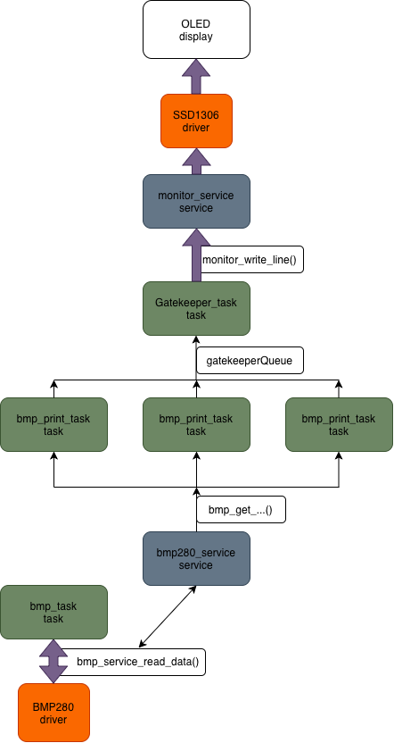
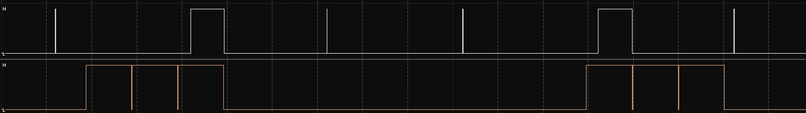
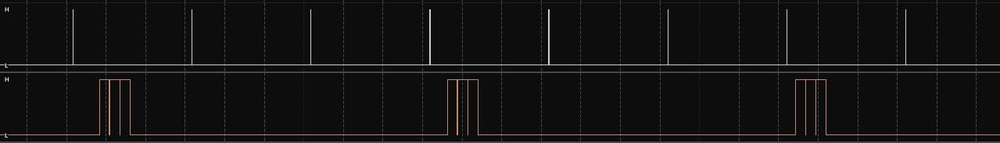

# STM32F446RE FreeRTOS Sensor Hub & UI Gatekeeper. V1.0.

## Overview

This repository contains a modular, real-time embedded system built on the **STM32F446RE** microcontroller using **FreeRTOS**.

The main objective of the project is to build a reliable telemetry and UI pipeline that reads data from an environmental sensor (BMP280) and renders updates on an OLED display via the shared I2C bus. The architecture avoids data races, minimizes ISR latency, and ensures high real-time predictability.

### Key Highlights:

- **Race-condition safe I2C Access:** Implemented the **Gatekeeper Task** pattern to serialize OLED display writes across multiple producing tasks.
- **Low Interrupt Latency:** Used **Deferred Interrupt Processing** to hand off hardware events from ISRs to RTOS tasks safely.
- **Deterministic Timing:** Measured and optimized task jitter on I2C bus speeds (100 kHz & 400 kHz) using a Saleae Logic Analyzer.
- **Memory Optimization:** Task stack allocation verified in real time via `uxTaskGetStackHighWaterMark` with a strict +30% safety margin.

## Run

```
make clean
make -j8
st-flash --reset write build/freertos_446.bin 0x08000000
```

`main.c` already has all needed tasks for work.

## Project structure

```
Project/
│
├──docs/
│   ├──v1.0/ ... Documentation for v1.0
├──Core/
│   ├── Inc/
│   │   ├── tasks/ ... FreeRTOS tasks. (bmp_task, gatekeeper and exc.)
│   │   ├── services/ ... Services that tasks uses for its work. (monitor_service, i2c_bus and exc.)
│   │   ├── handlers/ ... Interrupts handlers (ISR)
│   │   └── testing/ ... Testing functions (stack_size, jitter_test and exc.)
│   │
│   ├── Src/
│   │   ├── tasks/
│   │   ├── services/
│   │   ├── handlers/
│   └── └── testing/
│
├──Drivers/
│   ├── BMP280/ ... Driver for sensor BMP280
└── └── SSD1306/ ... Driver for OLED-display SSD1306
```

## Project Architecture



Used patterns:

- Gatekeeper (gatekeeper_task.c)
- Deferred interrupts processing (btn_handler.c)
- Task notifications (btn_handler.c)
- Mutex (i2c_bus.c).
- Producer-consumer pattern. (gatekeeperQueue).
- Layered Architecture (project structure).

## Engineering log

This topic is dedicated to the problems i encountered while developing this system.

1. `Watchdog`. First version was refreshing if every task had correct ping_time in interval. Since watchdog interval is 100ms, task could've failed 5 times (since `IWDG-timer` refresh time is about 0.6s) and send true in last 100ms and still pass through. Found it by chance - on some periods of time `IWDG` was OK, on some periods not. Solution: added flag `fault_occured`, which is by default `false`. If even once some of the tasks fails to ping, `fault_occured` will be set to `true` and `IWDG-timer` will never refresh again, causing reset of microcontroller.

2. `Gatekeeper`. At the start queue has been creating in main.c, which was causing a big problem: since `gatekeeper_task` is located in another file, it has its own stack. It means that we cannot send `gatekeeperQueue_handle` directly to task inside of `pvParameters`, because handle will now refer to some trash data (and it will also not be equal to NULL). Solution: moved `gatekeeperQueue_handle` to `ui_state.h` and made it global.

3. `BMP`. Same problem as with `Gatekeeper` now occured with `i2c_mutex`. Solution: move to complete new file `i2c_mutex.h`.

4. `Pages`. With new sensors arrived (coming soon), new problem occured - OLED-display is only `128x64` and can contain on it only 5 rows of data. Since `BMP` itself already takes 3 rows, only 2 rows were left for everything else. Solution: `Pages` system, that now can be switched with the help of the blue button.

5. `gatekeeper_watchdogMIN_TIME`. After adding `Pages`, new problem occured. Inside of `Gatekeeper_task`, if data that comes inside is located on another page, it saves, but not prints on the screen. Because of that execution of this `if-else branch` were taking less than `1ms` and watchdog thought that `Gatekeeper_task` broke and spamming. Solution: `Gatekeeper_task` now has `gatekeeper_watchdogMIN_TIME` == 0. With that, we are sure that `Gatekeeper_task` will never be spamming.

## Stack size

The table below summarize free stack words for every task. Makefile configuration : `-Og`.

_Note: 1 word equals 4 bytes on ARM Cortex-M4 architecture._

| Task ID | Task Name               | Allocated (Words / Bytes) | Unused Stack (High Water Mark) | Used Stack (Words / Bytes) | Peak Usage (%) | Status / Headroom            |
| ------- | ----------------------- | ------------------------- | ------------------------------ | -------------------------- | -------------- | ---------------------------- |
| **0**   | `bmp_print_task` (Temp) | 224 (896 B)               | 104                            | 120 (480 B)                | 53.6%          | Optimal (+104 words margin)  |
| **1**   | `bmp_print_task` (Pres) | 224 (896 B)               | 104                            | 120 (480 B)                | 53.6%          | Optimal (+104 words margin)  |
| **2**   | `bmp_print_task` (Alti) | 224 (896 B)               | 104                            | 120 (480 B)                | 53.6%          | Optimal (+104 words margin)  |
| **3**   | `bmp_task`              | 160 (640 B)               | 57                             | 103 (412 B)                | 64.4%          | Good (+57 words margin)      |
| **4**   | `gatekeeper_task`       | 320 (1280 B)              | 98                             | 222 (888 B)                | 69.4%          | Optimal (+98 words margin)   |
| **5**   | `page_task`             | 96 (384 B)                | 71                             | 25 (100 B)                 | 26.0%          | Very safe (+71 words margin) |
| **6**   | `watchdog_task`         | 96 (384 B)                | 71                             | 25 (100 B)                 | 26.0%          | Very safe (+71 words margin) |

## Jitter test

In this block i measured jitter for `bmp_task` and function `monitor_write_line` with logic analyzer, since these are the only processes that are not only periodic, but also use I2C bus.  
Measurements were taken on 100kHz and 400kHz rate of `I2C` bus.

### Quick introduction

`main.c`:

```
// MX_I2C1_Init()
hi2c1.Init.ClockSpeed = 400000;
// ...
```

`jitter_test.h`:

```
#define MARK_BMP_HIGH() (GPIOA->BSRR = GPIO_PIN_6)
#define MARK_BMP_LOW() (GPIOA->BSRR = (uint32_t)GPIO_PIN_6 << 16)
#define MARK_BUS_HIGH() (GPIOA->BSRR = GPIO_PIN_7)
#define MARK_BUS_LOW() (GPIOA->BSRR = (uint32_t)GPIO_PIN_7 << 16)
```

`bmp_task.c`:

```
#include "jitter_test.h"
// ...
for (;;)
{
    bmp_service_read_data();
    watchdog_ping(watchdog_task_id, xTaskGetTickCount());

    MARK_BMP_LOW(); // High on PA6
    vTaskDelayUntil(&wake_timeTICKS, pdMS_TO_TICKS(bmp_taskREFRESH_RATE_MS));
    MARK_BMP_HIGH(); // Low on PA6
}
```

`monitor_service.c`:

```
#include "jitter_test.h"
// ...
if (i2c_mutex_take(pdMS_TO_TICKS(monitorMAX_MUTEX_TIMEOUT_MS)) == pdTRUE)
{
    MARK_BUS_HIGH(); // High on PA7
    ssd1306_UpdateScreen(s_hi2c);
    MARK_BUS_LOW(); // Low on PA7
    i2c_mutex_give();
}
```

_Note: Full .sal files are in folder docs/v1.0/ ._

### For 100kHz:

As we can see on this screenshot:

`bmp_task` (white, channel 1):

- Works with vTaskDelayUntil, so intervals between its work is in range of 300 +- 1ms.
- Usually executes in `1ms`.
- Big rectangle called by a mutex waiting.

`monitor_write_line` (orange, channel 2):

- Works with interval of 800 +- 2ms.
- Has strict execute time of `101ms`.

### For 400kHz:



Basically the same, but execute time works 4 times faster (for example: `monitor_write_line` execution time is now `25ms`.)
