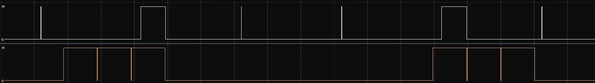
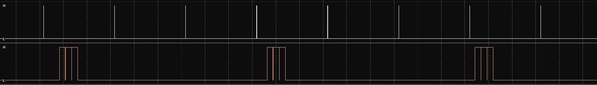

## Jitter test

In this block i measured jitter for `bmp_task` and function `monitor_write_line` with logic analyzer, since these are the only processes that are not only periodic, but also use I2C bus.  
Measurements were taken on 100kHz and 400kHz rate of `I2C` bus.

### Quick introduction

`main.c`:

```
// MX_I2C1_Init()
hi2c1.Init.ClockSpeed = 400000;
// ...
```

`jitter_test.h`:

```
#define MARK_BMP_HIGH() (GPIOA->BSRR = GPIO_PIN_6)
#define MARK_BMP_LOW() (GPIOA->BSRR = (uint32_t)GPIO_PIN_6 << 16)
#define MARK_BUS_HIGH() (GPIOA->BSRR = GPIO_PIN_7)
#define MARK_BUS_LOW() (GPIOA->BSRR = (uint32_t)GPIO_PIN_7 << 16)
```

`bmp_task.c`:

```
#include "jitter_test.h"
// ...
for (;;)
{
    bmp_service_read_data();
    watchdog_ping(watchdog_task_id, xTaskGetTickCount());

    MARK_BMP_LOW(); // High on PA6
    vTaskDelayUntil(&wake_timeTICKS, pdMS_TO_TICKS(bmp_taskREFRESH_RATE_MS));
    MARK_BMP_HIGH(); // Low on PA6
}
```

`monitor_service.c`:

```
#include "jitter_test.h"
// ...
if (i2c_mutex_take(pdMS_TO_TICKS(monitorMAX_MUTEX_TIMEOUT_MS)) == pdTRUE)
{
    MARK_BUS_HIGH(); // High on PA7
    ssd1306_UpdateScreen(s_hi2c);
    MARK_BUS_LOW(); // Low on PA7
    i2c_mutex_give();
}
```

_Note: Full .sal files are in folder docs/v1.0/ ._

### For 100kHz:

As we can see on this screenshot:

`bmp_task` (white, channel 1):

- Works with vTaskDelayUntil, so intervals between its work is in range of 300 +- 1ms.
- Usually executes in `1ms`.
- Big rectangle called by a mutex waiting.

`monitor_write_line` (orange, channel 2):

- Works with interval of 800 +- 2ms.
- Has strict execute time of `101ms`.

### For 400kHz:



Basically the same, but execute time works 4 times faster (for example: `monitor_write_line` execution time is now `25ms`.)
