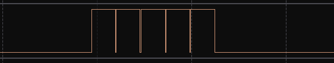
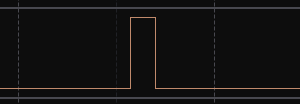

## monitor_service.c <- monitor_set_line and monitor_flush

### Overview

`monitor_service.c` now contains `monitor_set_line()` and `monitor_flush()`. Main idea: less bus-interactions on change page.

### Why?

Before with `monitor_write_line()` function, everytime in the function we made a bus-interaction. Each one could've took up to 100ms (if bus-speed was at 100kHz), which was not a good decision in this situation.

Now we set line in the buffer and flush it in once. With that, at page change we call `UpdateScreen()` function from `SSD1306.c` driver only once.

### Before:

  
(about 500ms of bus-using)

### After:

  
(about 100ms of bus-using)
