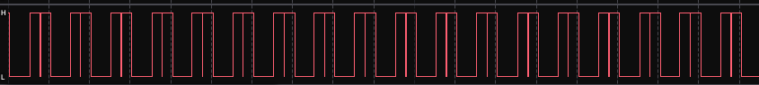
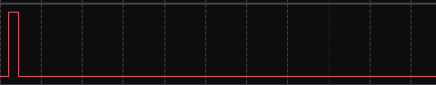

## monitor_service.c <- monitor_set_line and monitor_flush

### Overview

`monitor_service.c` now contains `monitor_set_line()` and `monitor_flush()`. Main idea: less bus-interactions on change page.

### I2C_bus freq = 400kHz

### Why?

Before with `monitor_write_line()` function, everytime in the function we made a bus-interaction. Each one could've took up to 100ms (if bus-speed was at 100kHz), which was not a good decision in this situation.

Now we set line in the buffer and flush it in once. With that, at page change we call `UpdateScreen()` function from `SSD1306.c` driver only once.

### Before:

  
(about 125ms of bus-using)

### After:

  
(about 25ms of bus-using)

### Update

After adding status page, big problem occured. As we can see on the next image:



Everytime status was coming to the queue, it was immediatly flushing on the screen. Because of that, every 50 ms `monitor_flush()` was called and every flush was calling twice, which was taking really long time.

`Solution`:

Added one line of code into `gatekeeper_service()`:

```
if (strcmp(task_data[data.task_id], data.data) != 0)
{
    ...
}
```

which was basically checking, if data that we got is the same, as we already have. If they are not the same, only then code would've been called. Now it looks like this for page 3 (status_page):


